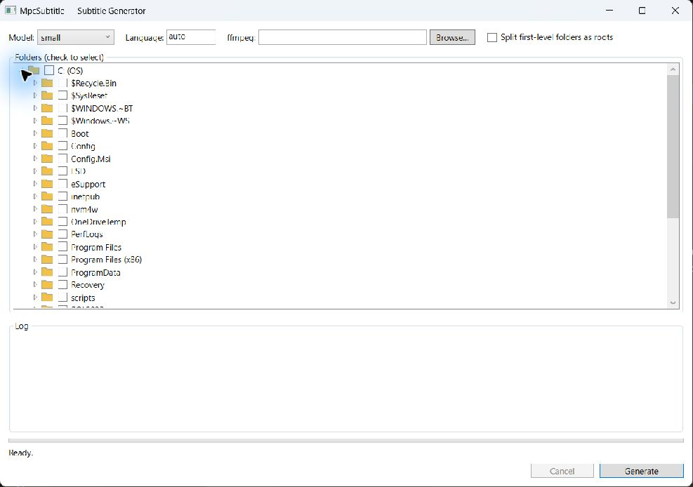

# MpcSubtitle

MpcSubtitle generates `.srt` subtitles from video or WAV audio with Whisper. It includes a Windows desktop application for batch-processing folders and a command-line application for processing individual files. After a model has been downloaded, transcription runs locally on your computer.



## Features

- Generate SubRip (`.srt`) subtitles next to your video files.
- Scan one or more folders recursively from a Windows desktop interface.
- Optionally treat every first-level folder as a separate scan root.
- Choose a Whisper model and use automatic language detection or an ISO language code.
- Review progress, cancel a batch, and choose how existing subtitles are handled.
- Process a single video or compatible WAV file from the CLI.
- Launch MPC-HC with the generated subtitle from the CLI when MPC-HC is installed.
- Reuse downloaded Whisper models from a local cache.

## Requirements

### Packaged Windows application

- 64-bit Windows.
- [FFmpeg](https://ffmpeg.org/download.html) for video input. FFmpeg is not included in the application package.
- Internet access the first time each named Whisper model is used.
- MPC-HC is optional and is only needed for automatic playback from the CLI.

The supplied Windows package is self-contained, so it does not require a separate .NET installation. The repository does not currently publish a downloadable GitHub Release; use a supplied `mpc-subtitle-win-x64.zip` package or build the application from source.

### Building from source

- Windows with the [.NET 8 SDK](https://dotnet.microsoft.com/download/dotnet/8.0).
- FFmpeg for video input.
- Git.

## Install the supplied Windows package

1. Extract `mpc-subtitle-win-x64.zip` to a writable folder, for example `C:\Apps\MpcSubtitle`.
2. Install FFmpeg and either:
   - add the folder containing `ffmpeg.exe` to your `PATH`, or
   - select `ffmpeg.exe` with the **Browse…** button in the desktop application.
3. Start the desktop application:

   ```text
   mpc-subtitle\MpcSubtitle.Gui\MpcSubtitle.Gui.exe
   ```

4. To use the command-line application, open a terminal in the extracted folder and run:

   ```powershell
   .\mpc-subtitle\MpcSubtitle.Cli\MpcSubtitle.Cli.exe --help
   ```

## First run

The default model is `small` and the default language is `auto`. When you use a named model for the first time, MpcSubtitle downloads its GGML model file and stores it in:

```text
%LOCALAPPDATA%\MpcSubtitle\models
```

The one-time download can range from roughly 50 MB to 3 GB depending on the selected model. Later runs reuse the cached file. The CLI can also accept a path to an existing GGML `.bin` model instead of a model name.

## Use the desktop application

1. Start `MpcSubtitle.Gui.exe`.
2. Select a Whisper **Model**. `small` is the default balanced choice.
3. Leave **Language** set to `auto`, or enter a language code such as `en` or `id`.
4. If FFmpeg is not on `PATH`, use **Browse…** to select `ffmpeg.exe`.
5. Expand the folder tree and check one or more folders.
6. Enable **Split first-level folders as roots** when each direct child folder should be processed as a separate root.
7. Select **Generate**.

The application scans the selected roots recursively and writes each subtitle beside its video using the same base filename. For example, `Episode 01.mkv` produces `Episode 01.srt`.

If an `.srt` file already exists, MpcSubtitle asks what to do:

- **Skip** — keep this subtitle and continue.
- **Skip All** — keep every existing subtitle for the rest of the batch.
- **Replace** — overwrite this subtitle.
- **Replace All** — overwrite every existing subtitle for the rest of the batch.

The log and status line show current progress. Select **Cancel** to stop an active batch.

## Use the CLI

From a source checkout:

```powershell
dotnet run --project src/MpcSubtitle.Cli/MpcSubtitle.Cli.csproj -- "C:\Videos\Episode 01.mkv" --language id --model small
```

From the supplied Windows package:

```powershell
.\mpc-subtitle\MpcSubtitle.Cli\MpcSubtitle.Cli.exe "C:\Videos\Episode 01.mkv" --language id --model small
```

Always quote paths that contain spaces.

> [!WARNING]
> The CLI overwrites an existing output file without prompting. Back up an existing subtitle or use `--out` to choose a different destination before running the command.

### CLI options

| Option | Description |
| --- | --- |
| `<input>` | Video file to process, or a 16 kHz mono PCM WAV file to transcribe directly. |
| `--model <name\|path>` | Named Whisper model or path to a local GGML `.bin` file. Default: `small`. |
| `-l`, `--language <code>` | ISO language code or `auto`. Default: `auto`. |
| `-o`, `--out <file.srt>` | Output path. Default: the input path with an `.srt` extension. |
| `--ffmpeg <path>` | Explicit path to `ffmpeg.exe`. Otherwise MpcSubtitle searches `PATH`. |
| `--mpc <path>` | Explicit path to MPC-HC. Otherwise common installation folders are searched. |
| `--no-play` | Generate the subtitle without launching MPC-HC. |
| `-h`, `--help` | Show CLI help. |

Example using a custom output path without starting MPC-HC:

```powershell
.\mpc-subtitle\MpcSubtitle.Cli\MpcSubtitle.Cli.exe "C:\Videos\Episode 01.mkv" `
  --model medium --language en --out "C:\Subtitles\Episode 01.srt" --no-play
```

## Whisper models

Available model names:

```text
tiny, tiny.en, base, base.en, small, small.en, medium, medium.en,
large, large-v1, large-v2, large-v3, large-v3-turbo
```

Smaller models download and transcribe faster while using less memory. Larger models generally need more time, memory, and disk space but can improve transcription quality. English-only models end in `.en`; use a multilingual model for Indonesian or other languages.

## Build and test from source

Clone the repository and enter the project folder:

```powershell
git clone https://github.com/muhammadbaiquni/c-sharp-projects.git
cd c-sharp-projects\mpc-subtitle
```

Restore, build, and test the solution:

```powershell
dotnet restore MpcSubtitle.sln
dotnet build MpcSubtitle.sln -c Release --no-restore
dotnet test MpcSubtitle.sln -c Release --no-build --verbosity minimal
```

Run the desktop application:

```powershell
dotnet run --project src/MpcSubtitle.Gui/MpcSubtitle.Gui.csproj -c Release
```

Run the CLI:

```powershell
dotnet run --project src/MpcSubtitle.Cli/MpcSubtitle.Cli.csproj -c Release -- --help
```

## Troubleshooting

### `ffmpeg not found`

Install a Windows FFmpeg build, then add its `bin` folder to `PATH`. Restart the terminal or application after changing `PATH`. In the desktop application, you can instead select `ffmpeg.exe` with **Browse…**. In the CLI, pass `--ffmpeg "C:\path\to\ffmpeg.exe"`.

### The model download fails

Check the internet connection and available disk space, then retry. Partial `.download` files are cleaned up after a failed download. Successfully downloaded models are stored under `%LOCALAPPDATA%\MpcSubtitle\models`.

### Transcription is slow or uses too much memory

Select a smaller model such as `tiny`, `base`, or `small`. Processing time depends on the selected model, media duration, and CPU performance.

### MPC-HC does not start

The generated subtitle is still saved. Install MPC-HC in a common installation folder, pass `--mpc "C:\path\to\mpc-hc64.exe"`, or load the subtitle manually in MPC-HC with **File → Load Subtitle** (`Ctrl+L`).

### A folder or file is skipped

Make sure the current Windows account can read the folder and write the `.srt` file beside the video. Inaccessible or removed directories are skipped during recursive scanning.

## Project layout

| Path | Purpose |
| --- | --- |
| `src/MpcSubtitle.Core` | FFmpeg extraction, Whisper model management and transcription, subtitle writing, and batch scanning. |
| `src/MpcSubtitle.Gui` | Windows WPF batch-processing application. |
| `src/MpcSubtitle.Cli` | Single-file command-line application and optional MPC-HC launch. |
| `tests/MpcSubtitle.Core.Tests` | Core behavior tests. |
| `tests/MpcSubtitle.Gui.Tests` | GUI view-model tests. |

## Project status

MpcSubtitle is under active development. The repository currently has no published GitHub Release, so build from source unless you received a packaged Windows ZIP.
